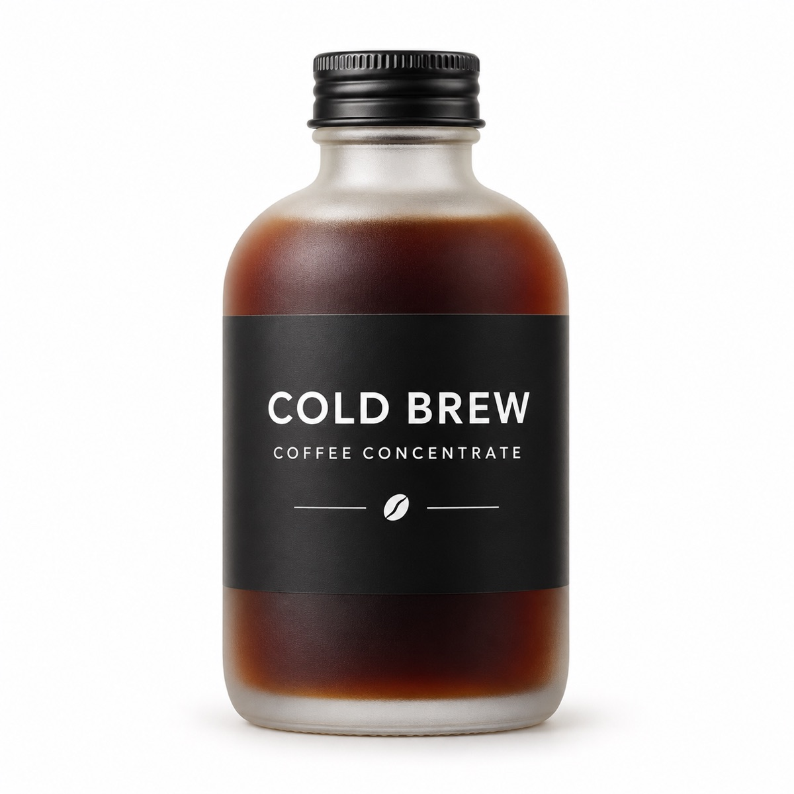

# Draftio Skills

[中文](README.md) · **English**

Draftio's entry point for your coding agent: when the task needs an image, it stops guessing at models and prices and hands back the model pick, a prompt written in that model's dialect, and the exact point cost read from the live API.

Model selection and pricing need no sign-up and no API key.

```bash
npx skills add mionax/draftio-skills
```

| | |
|---|---|
| <br>Xiaohongshu cover · `gpt-image-2` · 60 points | <br>White-background product shot · `gpt-image-2` · 60 points |
| <br>YouTube thumbnail · `gpt-image-2` · 60 points | <br>City food infographic · `gpt-image-2` · 60 points |

Every image above was generated by Draftio itself. Prompts and reproduction commands: [`assets/readme/README.md`](assets/readme/README.md). Zero typos in the Chinese headlines — that is what `gpt-image-2` is good at.

---

## Three tiers of friction: how far you get for free

| Stage | Account? | Pay? | What you get |
|---|---|---|---|
| Pick a model, write the prompt, get a quote | No | No | Told how to do it and what it costs |
| Generate | Yes (paste a `dk_live_` key) | Points are deducted | A real image, returned as a link |
| Top up | Yes | Yes | 1,000 points = ¥10 |

The first tier works the moment it's installed — and we say up front when money starts.

**500 points on sign-up** (valid for 30 days) ≈ 55 Z-Image Turbo images or 15 Seedream 5.5 images — enough to run the whole loop once.

## What it does

| | What | Why it matters |
|---|---|---|
| **Pick a model** | Given the scenario (Chinese poster, English layout, editing, multi-reference, 4K, artistic), recommends one primary and one alternative | The 20 models have different strengths; picking wrong means paying twice |
| **Write the prompt** | In each model's dialect: Chinese for Seedream/Qwen, structured English for GPT Image/Nano Banana, comma keyword flow + `--ar` for Midjourney | The same request needs a different phrasing per model; wrong phrasing means a wasted image |
| **Quote the price** | Gives the **entry price** and **per-resolution tier prices**, plus batch totals | Entry price ≠ every tier. Seedream 5.5 starts at 33 points (1K and 1.5K cost the same), 2K is 58; when you don't pick a resolution, billing follows the default tier returned by the API |

Prices are never hardcoded. The skill reads them on every run:

```bash
curl -s https://www.draftio.cn/api/v2/public/models
```

So new models and price changes can't leave you with stale numbers.

## Start here: GPT Image 2 series

For text, layout, retouching and precise edits — the tasks that most often produce throwaway images — go straight to the GPT Image 2 series. It is the most respected image model right now, and our price is low:

| Model | Best at | 1K | 2K | 4K |
|---|---|---|---|---|
| **GPT Image 2** | Strongest instruction following; complex layout, text edits, retouching | ¥0.60 (60 pts) | ¥0.80 (80 pts) | ¥1.20 (120 pts) |
| **GPT Image 2.5 Flare** | Fast tier; everyday edits and iteration | ¥0.60 | ¥0.80 | ¥1.20 |
| **GPT Image 2.5 Sunburst** | High tier; commercial retouching and fine detail | ¥0.71 (71 pts) | ¥0.80 | ¥1.20 |

Two things you may not be told elsewhere:

- **Quality tiers are free.** `low / medium / high` bill identically. Choosing high costs no more than low.
- **Editing is complete.** 1–16 reference images (2.5 series); text edits, background swaps and multi-image merges in one pass, no export/re-import loop.

For reference: OpenAI's high-quality 1024×1024 tier is about $0.211 per image (~¥1.5). We charge ¥0.60 at 1K.

## What it doesn't do

- **Without MCP it does not generate.** You get the plan and the price; the render happens in the [canvas](https://www.draftio.cn/canvas?utm_source=github&utm_medium=readme&utm_campaign=canvas). With MCP connected (`https://www.draftio.cn/mcp`) it gains `generate_image` and returns an HTTPS link directly.
- It cannot read your balance or your past renders.
- No video models (20 image models only).

These three points are blunt on purpose: the skill should not let the agent overpromise on our behalf.

## Example recipes (from our prompt library)

The skill works out what you are making, then pulls up one of these. All four are **adapted from templates already running in Draftio's prompt library** — not invented for the repo, just compressed into fill-in-the-blank form.

| Recipe | You might say | Primary model |
|---|---|---|
| [Xiaohongshu cover](examples/xiaohongshu-cover.md) | "make an XHS cover", "3:4 vertical with a headline" | `gpt-image-2` · from 60 pts |
| [Product shot / white background](examples/product-shot.md) | "make my product look premium", "clean white-background hero" | `gpt-image-2` · from 60 pts |
| [Video thumbnail](examples/youtube-thumbnail.md) | "YouTube thumbnail", "podcast cover 16:9" | `gpt-image-2` · from 60 pts |
| [Infographic / map](examples/infographic-map.md) | "city food map", "long-form infographic" | `gpt-image-2` · from 60 pts |

Each contains: when to use it, which models, a fill-in prompt template, parameters, an acceptance checklist, and a rework path when it goes wrong.

The files here are **text copies**. The authoritative version, with finished samples, lives at [prompt-library](https://www.draftio.cn/prompt-library?utm_source=github&utm_medium=readme&utm_campaign=prompt-library).

## Install

The single command at the top is enough: `npx skills add mionax/draftio-skills` detects the hosts in the current project and installs the skill at project level (not globally). The rest are other doors to the same room.

<details>
<summary>Install per host: Claude Code / Codex / Cursor / manual / script</summary>

### Claude Code

```bash
npx skills add mionax/draftio-skills
```

### Codex

```bash
codex plugin add github.com/mionax/draftio-skills
```

### Cursor / anything that reads `AGENTS.md`

Paste the body of [`skills/draftio-image/SKILL.md`](skills/draftio-image/SKILL.md) into your project's `.cursor/rules` or `AGENTS.md`. No dependencies.

### Manual

```bash
cp -r draftio-skills/skills/draftio-image .claude/skills/
```

### Script (clone first)

```bash
git clone https://github.com/mionax/draftio-skills.git
cd draftio-skills && ./install.sh
```

`./install.sh claude` / `codex` / `opencode` installs one host; `./install.sh list` only prints the destinations.

</details>

## Try it

**If it quotes numbers without fetching prices, the skill isn't installed properly.**

Once installed, tell your agent:

> Make a poster for a coffee shop opening. Chinese, vertical, warm tones, with the characters 「开业大吉」.

**What should happen:**

1. It fetches `/api/v2/public/models` for real prices.
2. It picks `seedream-v5-5` (best at Chinese text) or `qwen-image`, and says why.
3. It writes a prompt you can paste directly.
4. It quotes two lines, for example:

```
Seedream 5.5 · 1K / 1.5K · 33 points (¥0.33)
Seedream 5.5 · 2K · 58 points (¥0.58)  ← the default tier and the actual charge come from the API
```

## Why Draftio

- **One key, one bill.** Seedream / Qwen / Nano Banana / GPT Image / FLUX / Midjourney behind a single endpoint — no four cloud accounts and four signing schemes.
- **Alipay, RMB, one invoice.** No foreign cards, no PayPal.
- **Outputs land in the canvas.** No download-and-re-upload: keep editing, merging, outpainting.

## Pricing

Never cached, never hardcoded. These three are the source of truth:

- For humans: [draftio.cn/pricing/models](https://www.draftio.cn/pricing/models?utm_source=github&utm_medium=readme&utm_campaign=pricing-models) — 20 models, per-tier prices, including the default tier
- For machines: [`/api/v2/public/models`](https://www.draftio.cn/api/v2/public/models?utm_source=github&utm_medium=readme&utm_campaign=api-models) — points, tiers, images per call
- Plans and point packs: [`/api/v2/public/pricing`](https://www.draftio.cn/api/v2/public/pricing?utm_source=github&utm_medium=readme&utm_campaign=api-pricing)

## Model coverage

**GPT Image 2 · GPT Image 2.5 Flare · GPT Image 2.5 Sunburst** · Nano Banana · Nano Banana Pro · Nano Banana 2 · Seedream 5.5 · Seedream v5 Lite · Seedream v4.5 · Seedream v4 · Flux 2 Klein 9B · Flux 2 Klein 4B · Qwen Image · MiniMax H3 Image · Midjourney · Z-Image Turbo

## Why not call the official APIs yourself

Wiring them up isn't hard; keeping them wired up is. This is what the skill saves your agent:

| Step | Doing it yourself | Using this |
|---|---|---|
| Accounts | Alibaba, Volcano, Google, OpenAI — four accounts, four real-name checks | One Draftio account |
| API shapes | DashScope private format / Volcano v3 / Google / OpenAI | One OpenAI-compatible shape |
| Free quota | Claimed per vendor, mostly expires in 90 days, then hard errors | 500 points on sign-up |
| Billing | Five bills, five expense workflows, five invoices | One |
| Concurrency | Default 1–2, capacity upgrades in the ¥10k/month range | Queued, no extra charge |
| Price tracking | Your own price table, always out of date | One `curl`, always current |

The skill only handles **model choice, prompt writing and pricing** — the three things that need no credentials. Actual generation happens in the canvas, where images land in your asset library instead of your downloads folder.

## Troubleshooting

**Nothing happens after installing.** Make sure it installed into the current project (that's the default, not global), then restart the session. In Claude Code, `npx skills list` should show `draftio-image`.

**Its price disagrees with the site.** Ask it to paste the output of `curl -s https://www.draftio.cn/api/v2/public/models`. If it can't run that request, it's reciting old numbers — effectively not installed.

**It says it can generate for you.** It's making that up. This version selects models, writes prompts and quotes prices; rendering happens in the [canvas](https://www.draftio.cn/canvas?utm_source=github&utm_medium=readme&utm_campaign=canvas).

**Codex can't find the plugin.** Use `codex plugin add github.com/mionax/draftio-skills` rather than copying `plugin.json` around.

**Looking for other skills.** `npx skills find <keyword>`; feel free to run `npx skills find draftio` and see if we show up.

<details>
<summary>Repo layout</summary>

```
skills/draftio-image/SKILL.md     the only skill: model choice / prompts / pricing
plugin.json                       portable Agent Plugins manifest
.claude-plugin/plugin.json        Claude Code plugin manifest
.codex-plugin/plugin.json         Codex plugin manifest
install.sh                        one command, detects installed hosts
examples/*.md                     four scenario recipes (offline copies of prompt-library)
scripts/validate.mjs              validates manifests, frontmatter, examples
.github/workflows/validate.yml    runs on push / PR
```

</details>

## License

MIT

---

If this skill saved you one model-selection detour and one pricing lookup, a ⭐ helps others find it via `npx skills find`.

Bugs, wrong prices and model requests are all welcome as issues.
